# Música|deepin-music|

## Visão geral

O Música é um aplicativo dedicado à reprodução de músicas locais, com um novo design de interface e uma experiência de reprodução apurada. Ele também oferece funções como busca de músicas locais e sincronização da letra.

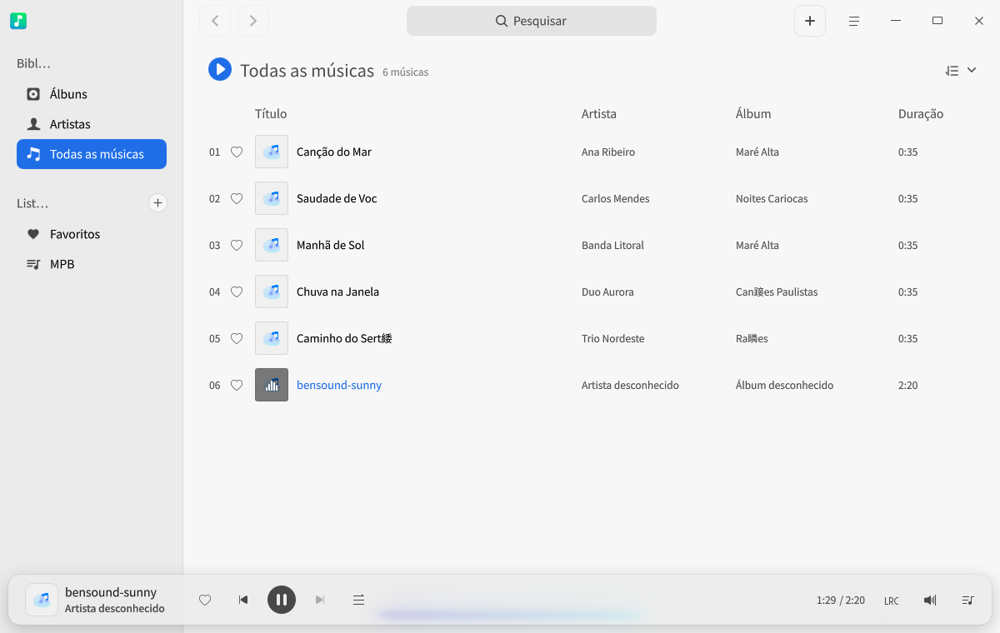

## Primeiros passos

Você pode iniciar o Música, fechá-lo ou criar um atalho das seguintes formas.

### Iniciar o Música

1. Clique no ícone do iniciador na barra de tarefas  para abrir a interface do iniciador.
2. Role a roda do mouse para cima ou para baixo ou use a busca para localizar o ícone do Música  e clique nele para iniciar.
3. Clique com o botão direito em  para:
   - Clicar em **Enviar para a área de trabalho** e criar um atalho na área de trabalho.
   - Clicar em **Enviar para a barra de tarefas** e fixar o aplicativo na barra de tarefas.
   - Clicar em **Iniciar automaticamente ao ligar** e adicionar o aplicativo aos itens de inicialização, para que ele seja executado automaticamente ao ligar o computador.

>  Observação: se o Música já estiver fixado na barra de tarefas por padrão, você também pode clicar no ícone  da barra de tarefas para iniciá-lo.

### Ocultar na bandeja do sistema

Na interface do Música, clique em  > **Configurações** e marque **Minimizar para a bandeja do sistema**. A partir daí, sempre que a janela principal for fechada, o Música é ocultado automaticamente na bandeja do sistema. Clique com o botão direito no ícone da bandeja para escolher:

- Reproduzir/Pausar.
- Faixa anterior.
- Próxima faixa.
- Sair.

### Fechar o Música

- Na interface do Música, se a ação definida para fechar a janela principal for sair, clique em  para sair do Música.
- Na bandeja do sistema, clique com o botão direito em  e selecione **Sair** para sair do Música.
- Na barra de tarefas, clique com o botão direito em  e selecione **Fechar tudo** para sair do Música.

### Consultar os atalhos

Na interface do Música, use o atalho **Ctrl + Shift + ?** para abrir a interface de visualização dos atalhos. Usar os atalhos com fluência aumenta bastante a sua produtividade.

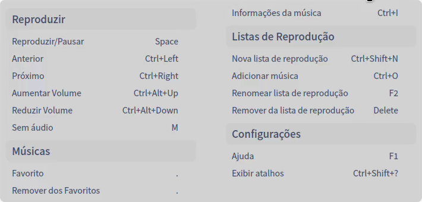

## Interface

Os botões da interface permitem realizar as operações comuns de reprodução, consultar a lista de reprodução e a letra, entre outras.

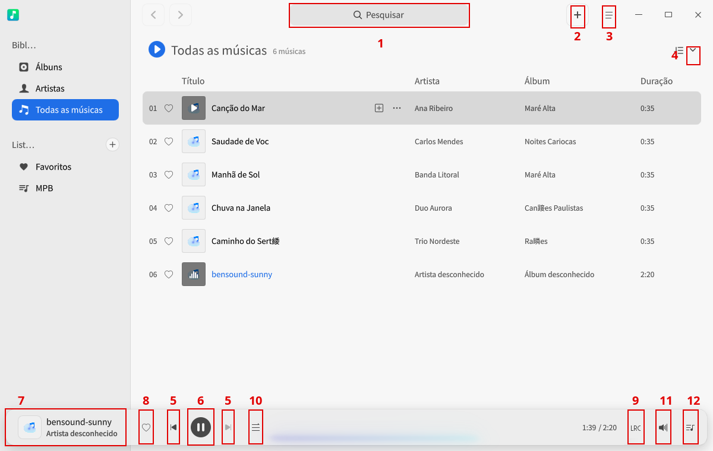

| Nº | Nome          | Descrição                                                         |
| ---- | ------------- | ------------------------------------------------------------ |
| 1    | Campo de busca        | Permite localizar músicas rapidamente pelo campo de busca.                                     |
| 2    | Adicionar música      | Adiciona arquivos de música à lista de reprodução.                                   |
| 3    | Menu principal        | A barra de menus permite criar listas, adicionar músicas, configurar o Música, consultar o manual de ajuda, sair do aplicativo e muito mais. |
| 4    | Ordenar por      | Ordena as músicas por data de adição, nome da música, nome do artista ou nome do álbum. A ordenação padrão é por data de adição. |
| 5    | Faixa anterior/Próxima | Muda para a faixa anterior ou para a próxima.                                    |
| 6    | Botão reproduzir/pausar | Reproduz ou pausa a música.                                              |
| 7    | Área de reprodução        | Mostra o nome, a capa e o artista da música em reprodução.                           |
| 8    | Favoritos          | Adiciona a música preferida à lista Meus favoritos; clique novamente para desfazer.     |
| 9    | Letra          | Alterna para a interface de letra; clique novamente para sair dela.                       |
| 10   | Modo de reprodução      | Alterna o modo de reprodução: repetir lista, repetir faixa ou aleatório.           |
| 11   | Volume      | Ajusta o volume.                                               |
| 12   | Fila de reprodução      | Abre a fila de reprodução.                                               |

## Operações comuns

No Música, você pode adicionar e excluir músicas locais, consultar informações e realizar outras operações básicas.

>  Observação: tecnologias de decodificação diferentes oferecem conjuntos de recursos diferentes; considere o que aparece na interface real.

### Adicionar músicas

Na interface do Música, adicione músicas de uma das seguintes formas:

- Clique no botão de adicionar da barra de título .
- Clique em  > **Adicionar música**.
- Arraste os arquivos de música diretamente para a interface do Música.

>  Observação: quando não há músicas na interface, você também pode clicar em **Adicionar música**, **Adicionar caminho de música** ou **Procurar** no diretório de músicas. Quando já há músicas na interface, você também pode adicioná-las clicando com o botão direito em um item da biblioteca de músicas ou das minhas listas.

### Pesquisar músicas

1. No campo de busca da interface do Música, clique em  e digite a palavra-chave.   
2. Pressione a tecla **Enter** do teclado para pesquisar.
3. No campo de busca, clique em  ou apague o texto digitado para limpar o que foi digitado ou cancelar a pesquisa.

### Reproduzir músicas

Reproduza músicas de uma das seguintes formas:

- Na lista de músicas, clique duas vezes na faixa ou clique com o botão direito e selecione **Reproduzir** para tocar a faixa atual.
- Na lista de músicas, clique em **Reproduzir tudo** para tocar todas as faixas da lista atual na ordem de reprodução configurada.
- Selecione uma lista, clique com o botão direito em **Reproduzir** para tocar todas as faixas da lista na ordem de reprodução configurada.

> Dica: na interface do Música, clique em  para reproduzir a faixa selecionada; clique em  para pausar a faixa em reprodução; clique em  ou  para mudar para a faixa anterior ou a próxima, conforme o modo de reprodução atual.

### Favoritar músicas

1. Na interface do Música, reproduza um arquivo de música.
2. Clique em  na barra de ferramentas para adicionar a música atual à lista "Meus favoritos".

>  Dica: você também pode clicar com o botão direito no arquivo de música e selecionar **Adicionar à lista** > **Meus favoritos**; a música é adicionada à lista "Meus favoritos".

### Consultar a letra

Na interface do Música, clique no ícone  da barra de ferramentas ou em  para alternar para a interface de letra; clique novamente para recolhê-la.

>  Observação: se o arquivo de música em reprodução tiver imagem de capa, o ícone  é substituído por essa capa, e clicar na capa também alterna para a interface de letra.

### Ajustar o modo de reprodução

Na interface do Música, clique em ,  ou  para ajustar o modo de reprodução.

Sendo:

: Repetir faixa

: Aleatório

: Repetir lista

### Exibir no gerenciador de arquivos

1. Na interface do Música, clique com o botão direito no arquivo de música.
2. Selecione **Abrir no gerenciador de arquivos** para localizar onde a música está armazenada.

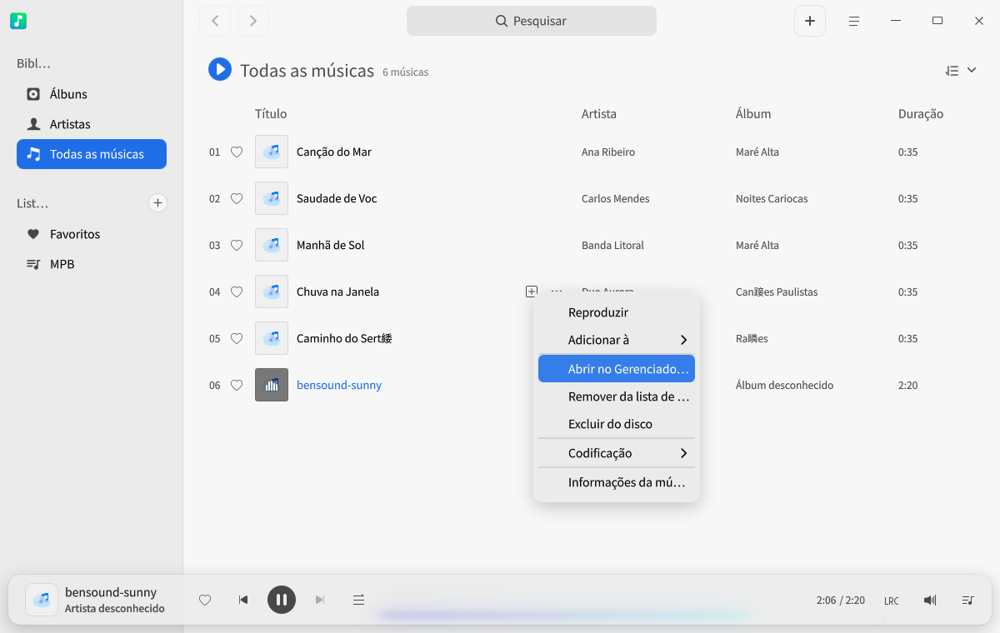

### Excluir músicas

Na lista de reprodução, clique com o botão direito no arquivo de música que deseja excluir:

- Selecione **Remover da lista** e clique em **Remover** na caixa de diálogo; o arquivo sai da lista de faixas, mas permanece na pasta local.
- Selecione **Excluir do dispositivo local** e clique em **Excluir** na caixa de diálogo; o arquivo sai da lista de faixas e também é excluído da pasta local.

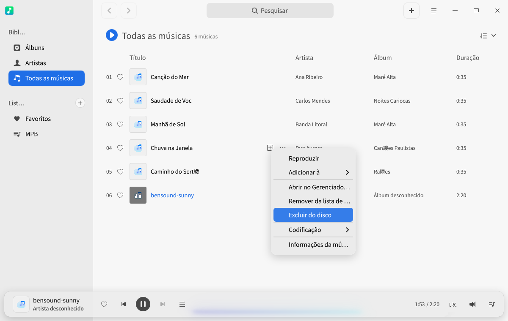

### Definir a codificação

Para faixas exibidas com caracteres ilegíveis, troque a codificação para que o texto seja exibido corretamente.

1. Na lista de reprodução, clique com o botão direito no arquivo de música.
2. Clique em **Codificação** e escolha outra codificação.

### Consultar as informações da música

1. Na lista de reprodução, clique com o botão direito no arquivo de música.
2. Selecione **Informações da música** para ver os detalhes da faixa.

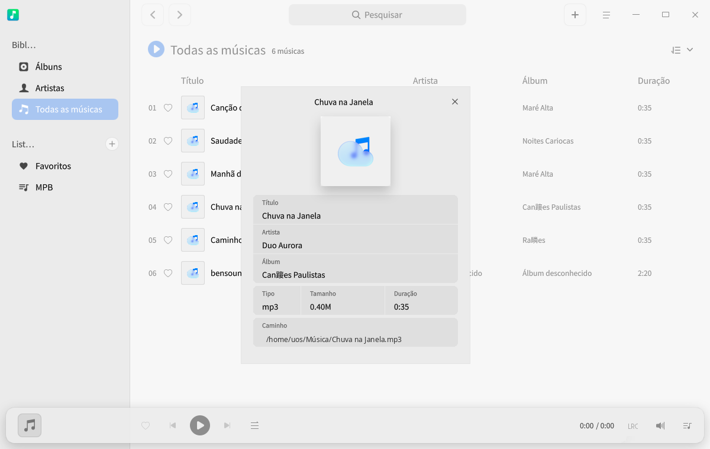

## Gerenciamento de listas

Na interface do Música, você pode criar listas, renomeá-las, excluí-las e adicionar músicas às minhas listas, entre outras operações.

>  Observação: **Todas as músicas** é a lista padrão e não pode ser excluída. **Todas as músicas** reúne as músicas de todas as listas. Você pode gerenciar as músicas favoritas diretamente na lista **Meus favoritos** ou pelo botão de favoritos da interface principal.

### Adicionar uma nova lista

1. Na interface do Música, clique no botão à direita de "Minhas listas"  ou em  > **Adicionar nova lista**.
2. Digite o nome da lista e pressione a tecla **Enter** do teclado para salvar.

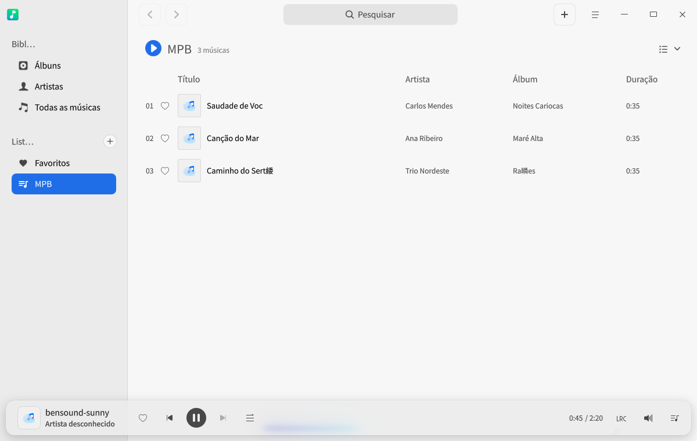

### Renomear uma lista

1. Selecione uma lista na lista "Minhas listas".
2. Clique com o botão direito e selecione **Renomear**.
3. Digite o novo nome e pressione a tecla **Enter** do teclado para salvar.

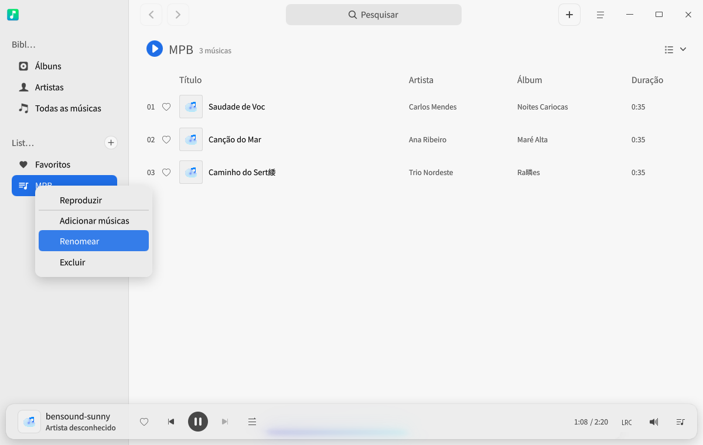

### Adicionar músicas a uma lista

1. Na interface do Música, selecione um arquivo de música.
2. Clique com o botão direito.
3. Selecione **Adicionar à lista** e escolha a lista de destino.  

>  Dica: você pode arrastar uma faixa local para uma lista específica; a faixa passa a fazer parte dessa lista e também de todas as músicas.

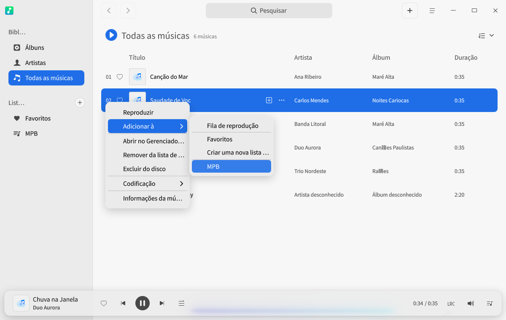

### Remover músicas de uma lista

1. Em "Minhas listas", selecione uma lista e escolha um arquivo de música dessa lista.
2. Clique com o botão direito.
3. Selecione **Remover da lista** para retirar da lista o arquivo selecionado.

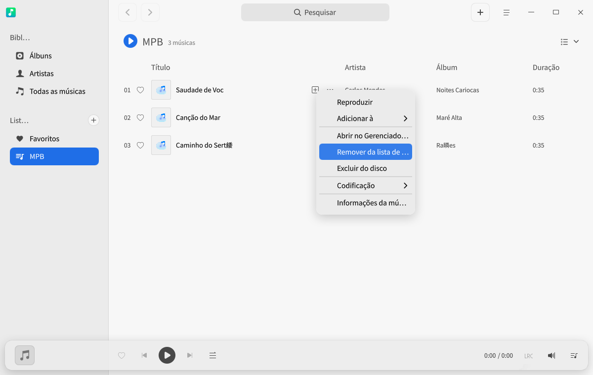

### Excluir uma lista

1. Em "Minhas listas", selecione a lista que deseja excluir.
2. Clique com o botão direito e selecione **Excluir**.
3. Na caixa de diálogo exibida, clique em **Excluir**.

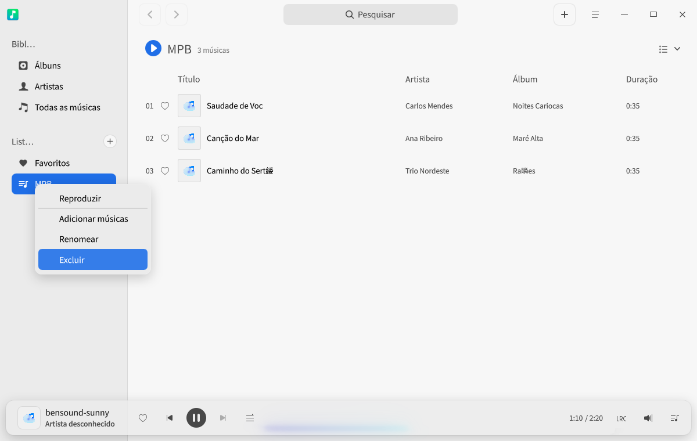

## Menu principal

No menu principal, você pode [adicionar uma nova lista](#adicionar-uma-nova-lista), [adicionar músicas](#adicionar-músicas), ajustar o equalizador, configurar as informações do Música, alternar o tema da janela, consultar o manual de ajuda e saber mais sobre o aplicativo.

### Equalizador

Ajuste a qualidade do áudio no equalizador para alcançar o efeito sonoro desejado.

1. Na interface do Música, clique em .
2. Selecione **Equalizador**.
3. Depois de ativar o **Equalizador**, ajuste manualmente o ganho de "Pré-amplificação" e as bandas de frequência e clique em **Salvar**, ou escolha um modo de música na lista suspensa de modos; nesse caso, o sistema salva a configuração automaticamente.
4. Clique em **Restaurar padrões** para voltar às configurações de fábrica.

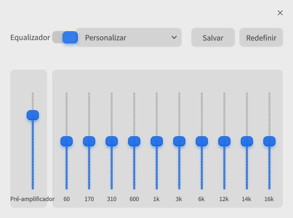

### Configurações

#### Configurações básicas

1. Na interface do Música, clique em .
2. Selecione **Configurações** e faça os ajustes abaixo.
   - Na opção **Reprodução**:
      - Marque **Reproduzir automaticamente ao iniciar** para que a música comece a tocar assim que o Música for iniciado.
      - Marque **Lembrar o progresso da última reprodução** para continuar do ponto em que a reprodução parou na última vez.
      - Marque **Ativar fade in e fade out** para que o som aumente gradualmente ao iniciar a reprodução e diminua gradualmente ao sair do aplicativo.
   - Na opção **Fechar a janela principal**:
      - Selecione **Minimizar para a bandeja do sistema** para ocultar o aplicativo na bandeja do sistema ao fechar a janela principal.
      - Selecione **Sair** para encerrar o aplicativo ao fechar a janela principal.
      - Selecione **Perguntar sempre** para exibir uma confirmação a cada fechamento da janela principal.

#### Configurações de atalhos

1. Na interface do Música, clique em .
2. Selecione **Configurações**.
3. Na opção **Atalhos**, consulte os atalhos atuais; você também pode definir atalhos próprios.

### Tema

O tema da janela inclui tema claro, tema escuro e tema do sistema.

1. Na interface do Música, clique em .
2. Selecione **Tema** e escolha uma cor de tema.

### Ajuda

Consulte o manual de ajuda para conhecer melhor o Música e usá-lo com mais facilidade.

1. Na interface do Música, clique em .
2. Selecione **Ajuda**.
3. Consulte o manual de ajuda do Música.

### Sobre

1. Na interface do Música, clique em .
2. Selecione **Sobre**.
3. Consulte a versão e a descrição do Música.

### Sair

1. Na interface do Música, clique em .
2. Selecione **Sair**.
